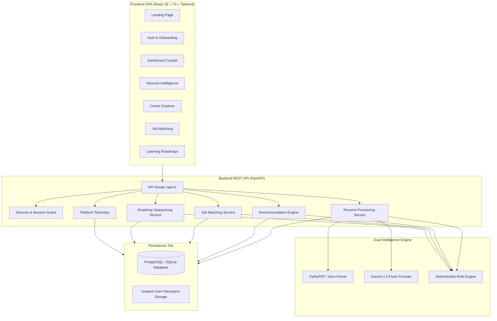

# CareerCompass AI — AI-Powered Career Intelligence Platform

> **Turn Your Skills Into Your Next Opportunity.**

CareerCompass AI is a high-quality, responsive, AI-powered career intelligence and employability SaaS platform. It bridges the gap between academic/self-taught backgrounds, raw resumes, and current tech market expectations by delivering structured ATS document parsing, explainable career recommendation algorithms, deterministic skill-gap diagnostics, resume-to-job compatibility scoring, and personalized learning roadmaps.

---

## 1. Key Platform Capabilities

1. **Resume Intelligence & ATS Audit**
   - Ingestion of PDF, DOCX, and TXT resumes with automatic text sanitization.
   - Dual-engine analysis: Google Gemini 1.5 Flash when API key is provided, with a 100% offline deterministic rule-based NLP engine as fallback.
   - ATS Readability Scoring (0–100) based on standard sectioning, contact headers, and quantified metrics.
   - Categorized extraction: Summary, Skills, Experience, Education, Projects, Strengths, Weaknesses, and Actionable Recommendations using Google's X-Y-Z formula.
   - Review screen allowing users to inspect and adjust extracted details.

2. **Explainable Career Role Explorer**
   - Curated taxonomy of high-demand tech positions (Full-Stack Engineer, ML Engineer, Cloud & DevOps, Data Scientist, Backend Platform Engineer, Frontend Engineer).
   - Transparent mathematical recommendation score:
     $$\text{Score} = 0.50 \cdot \text{Match}_{\text{required}} + 0.25 \cdot \text{Match}_{\text{preferred}} + 0.15 \cdot \text{Experience} + 0.10 \cdot \text{Education}$$
   - Deep Skill Gap Matrix highlighting Acquired skills, Critical missing blockers, and Secondary growth opportunities.

3. **Job Compatibility Matching & Application Tracker**
   - Curated sample vacancies clearly badged as "Curated Demo Vacancies".
   - Custom Job Description Analyzer: Paste any external JD from LinkedIn or Indeed to calculate immediate compatibility.
   - Multi-stage Kanban application tracker (`Saved`, `Applied`, `Interviewing`, `Offered`, `Archived`) supporting both curated platform vacancies and custom external postings.

4. **Personalized Learning Roadmaps**
   - Sequenced milestones that prioritize missing prerequisite competencies before advanced tools.
   - Tuned to learner commitment pace (Steady: 5–8 hrs/wk, Moderate: 10–15 hrs/wk, Intensive: 20+ hrs/wk).
   - Milestone capstone project challenges and direct links to curated, free documentation and courses.
   - Interactive milestone checkboxes that update roadmap progress percentages in real-time.

5. **AI Interview Readiness Studio & STAR Practice Canvas**
   - Synthesizes tailored technical deep-dive questions, behavioral STAR prompts (Situation, Task, Action, Result), and system design scenarios mapped directly to missing skill gaps or target positions.
   - Interactive model answers, high-impact candidate talking points, and critical anti-pattern pitfalls to avoid.
   - Candidate practice notes sandbox, 5-star self-evaluation mastery tracking, and dynamic session readiness index.

6. **Security, Privacy & GDPR Controls**
   - Bcrypt password hashing and JWT authentication with role-based access control (`user` and `admin`).
   - Strict tenant query isolation (`WHERE user_id = current_user.id`).
   - One-click offline GDPR Article 20 data portability export (`/api/v1/users/export` full relational archive JSON) and complete Right-to-Erasure account purging.


---

## 2. Technology Stack

| Layer | Technologies |
|---|---|
| **Frontend** | React 18, TypeScript (Strict Mode), Vite, Tailwind CSS, Lucide React, TanStack Query |
| **Backend** | Python 3.12, FastAPI, Pydantic v2, SQLAlchemy 2.0, Bcrypt, PyJWT |
| **Document Processing** | PyMuPDF (fitz), python-docx |
| **AI Engine** | Google Gemini 1.5 Flash + Deterministic Rule & NLP Engine |
| **Databases** | PostgreSQL (Production) / SQLite (Zero-config local development) |
| **Infrastructure** | Docker, Docker Compose, Nginx |

---

## 3. Architecture Overview



---

## 4. Getting Started

### 4.1 Prerequisites
- Python 3.11+
- Node.js 18+ and npm
- (Optional) Docker & Docker Compose

### 4.2 Quick Start (Zero-Config Local Development)

#### 1. Backend Setup
```bash
# Navigate to backend
cd backend

# Create and activate virtual environment
python3 -m venv venv
source venv/bin/activate

# Install dependencies
pip install -r requirements.txt

# Run migrations and seed data
python -m app.seed_data

# Launch FastAPI development server
python -m app.main
```
The backend API is now running at `http://localhost:8000`. Interactive OpenAPI documentation is accessible at `http://localhost:8000/api/v1/docs`.

#### 2. Frontend Setup
In a new terminal window:
```bash
# Navigate to frontend
cd frontend

# Install npm dependencies
npm install

# Start Vite dev server
npm run dev
```
Open `http://localhost:5173` in your browser.

---

### 4.3 Pre-seeded Demo Credentials

For quick evaluation without manual sign-up, the database is pre-seeded with:
- **Demo Student**: `student@careercompass.ai` / `StudentPassword123!`
- **Platform Administrator**: `admin@careercompass.ai` / `AdminPassword123!`

---

## 5. Dockerized Deployment

To launch the full multi-container stack (PostgreSQL, FastAPI Backend, and Nginx-served React SPA) in a single command:

```bash
docker-compose up --build
```

- Web Application: `http://localhost:3000`
- REST API: `http://localhost:8000`
- PostgreSQL: `localhost:5432`

---

## 6. Verification and Automated Tests

### 6.1 Backend Test Suite (Pytest)
```bash
cd backend
source venv/bin/activate
pytest tests -v
```
The test suite validates:
- Registration, login, password hashing, and token authentication (`test_auth.py`).
- Resume upload, file size guards, ATS parsing, and profile syncing (`test_resumes.py`).
- Deterministic career recommendations and skill gap formulas (`test_careers.py`).
- Job compatibility calculations and application pipeline tracking (`test_jobs.py`).
- Roadmap sequencing and milestone step toggling (`test_learning.py`).

### 6.2 Frontend Production Build & TypeScript Verification
```bash
cd frontend
npm run build
```
Executes strict TypeScript type checking (`tsc`) and Vite asset bundling.

---

## 7. Project Documentation Index

Detailed technical specifications are available in the [`docs/`](file:///Users/haricharan/Documents/Career%20Intelligence%20Platform/docs) directory:
- [Requirements Document](file:///Users/haricharan/Documents/Career%20Intelligence%20Platform/docs/requirements.md)
- [System Architecture](file:///Users/haricharan/Documents/Career%20Intelligence%20Platform/docs/architecture.md)
- [Database Schema Design](file:///Users/haricharan/Documents/Career%20Intelligence%20Platform/docs/database-design.md)
- [REST API Specification](file:///Users/haricharan/Documents/Career%20Intelligence%20Platform/docs/api-specification.md)
- [AI & Recommendation Engine Design](file:///Users/haricharan/Documents/Career%20Intelligence%20Platform/docs/ai-design.md)
- [Security & Privacy Architecture](file:///Users/haricharan/Documents/Career%20Intelligence%20Platform/docs/security-and-privacy.md)
- [Testing & Quality Assurance](file:///Users/haricharan/Documents/Career%20Intelligence%20Platform/docs/testing.md)
- [Deployment & Operations Guide](file:///Users/haricharan/Documents/Career%20Intelligence%20Platform/docs/deployment.md)
- [End-User Guide & Feature Manual](file:///Users/haricharan/Documents/Career%20Intelligence%20Platform/docs/user-guide.md)
- [Implementation Progress Tracker](file:///Users/haricharan/Documents/Career%20Intelligence%20Platform/docs/implementation-progress.md)

---

## 8. License
Individual internship project deliverable. Built for CareerCompass AI.
