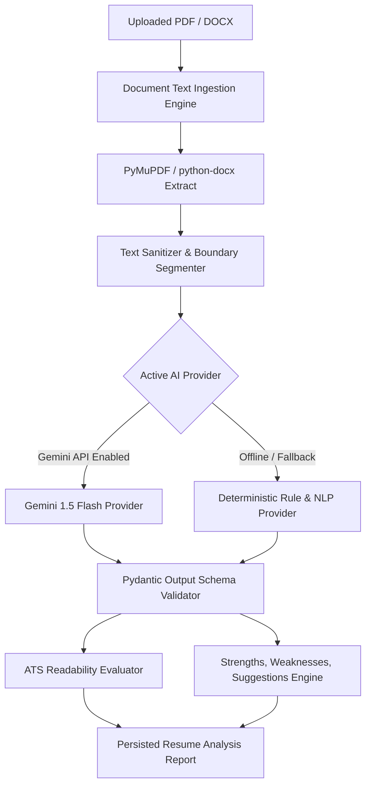

# CareerCompass AI — AI & Recommendation Engine Specification

## 1. Design Philosophy
CareerCompass AI rejects opaque "black box" percentages and hallucinated recommendations. The intelligence engine is founded on three pillars:
1. **Explainable Mathematics**: Every match score, gap metric, and readiness rating is derived from explicit, inspectable formulas.
2. **Dual-Engine Architecture**: A hybrid design pairing Google's Gemini LLM with a 100% offline Deterministic Rule & NLP Engine. If an API key is absent or an external provider fails, the system automatically runs deterministic parsing and scoring without degrading user workflow.
3. **Pydantic Validation Guardrails**: All structured outputs are forced into rigorous Pydantic schemas before persistence, discarding malformed model payloads.

---

## 2. Mathematical Scoring Formulas

### 2.1 Career Role Recommendation Score
The compatibility of a user profile $U$ against a career role $R$ is calculated as:
$$\text{Score}(U, R) = w_r \cdot M_{\text{req}} + w_p \cdot M_{\text{pref}} + w_e \cdot E_{\text{exp}} + w_d \cdot E_{\text{edu}}$$

Where:
- $w_r = 0.50$: Weight for required core skills.
- $w_p = 0.25$: Weight for preferred secondary skills.
- $w_e = 0.15$: Weight for relevant experience years alignment.
- $w_d = 0.10$: Weight for relevant education background.

Skill Overlap Calculation:
$$M_{\text{req}} = \frac{|\text{Skills}(U) \cap \text{RequiredSkills}(R)|}{|\text{RequiredSkills}(R)|} \times 100$$
$$M_{\text{pref}} = \frac{|\text{Skills}(U) \cap \text{PreferredSkills}(R)|}{\max(1, |\text{PreferredSkills}(R)|)} \times 100$$

### 2.2 Skill Gap Severity
For any role, missing skills are categorized:
- **Critical Gaps** ($\text{Severity} = \text{High}$): Required skills missing from the user's verified profile.
- **Secondary Gaps** ($\text{Severity} = \text{Medium}$): Preferred skills missing from the user's profile.
- **Growth Potential** ($\text{Severity} = \text{Low}$): Emerging industry tools related to the role domain.

### 2.3 Job Description Match Score
Given a user resume text $T_R$ and a job description $T_{JD}$:
1. **Skills Alignment** ($60\%$ weight): Overlap between extracted JD requirements and verified profile skills.
2. **Context & Semantic Density** ($25\%$ weight): Term frequency-inverse context weighting of industry keywords (cloud platforms, database systems, testing frameworks).
3. **Experience Recency & Seniority** ($15\%$ weight): Ratio of candidate experience to requested job years.

---

## 3. Resume Intelligence Pipeline

### ATS Readability Criteria:
- Contact information completeness (Email, Phone, LinkedIn, GitHub).
- Standard section headers detected (Education, Experience, Projects, Skills).
- Metric quantification in bullet points (percentages, performance multipliers, user counts).
- Active voice and action verb density (Architected, Engineered, Optimized, Spearheaded vs. "Worked on").
- Avoidance of unreadable tables or complex graphic artifacts.

---

## 4. Personalized Roadmap Sequencing
The roadmap engine sequences learning steps using a directed dependency tree:
1. **Foundational Prerequisites**: Core languages & runtime concepts (e.g., Python, TypeScript).
2. **Primary Frameworks**: Core architectural libraries (e.g., FastAPI, React, Docker).
3. **Data & Storage Systems**: Relational & NoSQL persistence (e.g., PostgreSQL, Redis).
4. **Production Engineering**: CI/CD, testing, cloud deployment, monitoring.

Each step includes:
- Estimated time commitment in hours.
- Curated, free and recognized external resource URLs (MDN, Python.org docs, freeCodeCamp, roadmap.sh).
- Concrete milestone project challenge to demonstrate practical mastery.
