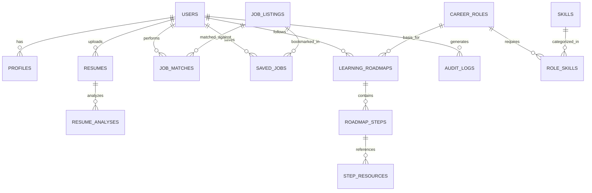

# CareerCompass AI — Database Schema Specification

## 1. Entity-Relationship Overview

---

## 2. Table Specifications

### 2.1 `users`
Represents platform accounts with authentication credentials and role flags.
| Column | Type | Constraints | Description |
|---|---|---|---|
| `id` | Integer / UUID | PK, Auto-increment | Unique user identifier |
| `email` | String(255) | Unique, Not Null, Index | User login email |
| `hashed_password` | String(255) | Not Null | Hashed password (bcrypt) |
| `full_name` | String(255) | Not Null | User full name |
| `is_active` | Boolean | Default True | Active status flag |
| `is_superuser` | Boolean | Default False | Administrative permissions flag |
| `created_at` | DateTime | Default UTC now | Account creation timestamp |
| `updated_at` | DateTime | On update UTC now | Last update timestamp |

### 2.2 `profiles`
Stores structured user background, target preferences, and career onboarding details.
| Column | Type | Constraints | Description |
|---|---|---|---|
| `id` | Integer | PK, Auto-increment | Profile ID |
| `user_id` | Integer | FK(`users.id`), Unique | Associated user |
| `headline` | String(255) | Nullable | e.g. "Computer Science Senior" |
| `years_of_experience`| Float | Default 0.0 | Total professional experience |
| `education_level` | String(100) | Nullable | e.g. "Bachelor's Degree", "Self-Taught" |
| `institution` | String(255) | Nullable | University or college name |
| `graduation_year` | Integer | Nullable | Expected or completed graduation year |
| `target_role` | String(150) | Nullable | Primary desired role |
| `learning_pace` | String(50) | Default "moderate"| "steady", "moderate", "intensive" |
| `career_goals` | Text | Nullable | Freeform career objectives |
| `skills` | JSON | Default [] | List of verified skills [name, level] |
| `completeness_score`| Integer | Default 0 | Profile completeness % (0-100) |

### 2.3 `resumes` & `resume_analyses`
Tracks raw resume files and extracted structured AI analysis reports.
- `resumes`:
  - `id`: PK
  - `user_id`: FK(`users.id`)
  - `filename`: String (original filename)
  - `file_path`: String (stored path)
  - `file_type`: String ("pdf", "docx")
  - `file_size_bytes`: Integer
  - `uploaded_at`: DateTime
- `resume_analyses`:
  - `id`: PK
  - `resume_id`: FK(`resumes.id`)
  - `ats_score`: Integer (0-100)
  - `summary`: Text
  - `extracted_skills`: JSON (categorized skills array)
  - `extracted_experience`: JSON (roles, companies, dates, bullets)
  - `extracted_education`: JSON (degree, school, year, GPA)
  - `extracted_projects`: JSON (project titles, tech, descriptions)
  - `strengths`: JSON (array of strength statements)
  - `weaknesses`: JSON (array of weaknesses and missing elements)
  - `recommendations`: JSON (array of actionable tips with rationale)
  - `ai_provider`: String ("gemini", "deterministic")
  - `created_at`: DateTime

### 2.4 `career_roles` & `skills`
Master taxonomies of industry positions, required proficiencies, and learning difficulty.
- `career_roles`:
  - `id`: PK
  - `title`: String (e.g., "Machine Learning Engineer")
  - `slug`: String, Unique
  - `domain`: String (e.g., "AI / Data", "Software Engineering", "Cloud")
  - `description`: Text
  - `average_salary`: String (e.g., "$110,000 - $145,000")
  - `experience_level`: String ("Entry-Level", "Mid-Level", "Senior")
  - `is_active`: Boolean
- `skills`:
  - `id`: PK
  - `name`: String, Unique (e.g., "Python", "PyTorch", "Docker")
  - `category`: String ("Language", "Framework", "Database", "DevOps", "Tool")
- `role_skills`:
  - `role_id`: FK(`career_roles.id`)
  - `skill_id`: FK(`skills.id`)
  - `is_required`: Boolean (True = Core requirement, False = Preferred)
  - `weight`: Float (1.0 to 3.0)

### 2.5 `job_listings` & `job_matches`
Curated demo vacancies and explainable compatibility scores.
- `job_listings`:
  - `id`: PK
  - `title`: String
  - `company`: String
  - `location`: String (e.g., "San Francisco, CA (Remote)")
  - `job_type`: String ("Full-time", "Internship", "Contract")
  - `salary_range`: String
  - `description`: Text
  - `required_skills`: JSON
  - `preferred_skills`: JSON
  - `is_sample`: Boolean Default True
- `job_matches`:
  - `id`: PK
  - `user_id`: FK(`users.id`)
  - `job_id`: FK(`job_listings.id`), Nullable (if custom paste)
  - `compatibility_score`: Integer (0-100)
  - `matched_skills`: JSON
  - `missing_skills`: JSON
  - `experience_score`: Integer (0-100)
  - `tailoring_advice`: JSON
  - `created_at`: DateTime

### 2.6 `saved_jobs`
Application pipeline tracking for target jobs.
- `id`: PK
- `user_id`: FK(`users.id`)
- `job_id`: FK(`job_listings.id`)
- `status`: String ("saved", "applied", "interviewing", "offered", "rejected")
- `notes`: Text
- `updated_at`: DateTime

### 2.7 `learning_roadmaps` & `roadmap_steps`
Ordered milestones, skill sequencing, and tracking.
- `learning_roadmaps`:
  - `id`: PK
  - `user_id`: FK(`users.id`)
  - `role_id`: FK(`career_roles.id`), Nullable
  - `title`: String
  - `target_role`: String
  - `estimated_weeks`: Integer
  - `progress_percentage`: Integer (0-100)
  - `created_at`: DateTime
- `roadmap_steps`:
  - `id`: PK
  - `roadmap_id`: FK(`learning_roadmaps.id`)
  - `step_order`: Integer
  - `title`: String
  - `skill_name`: String
  - `description`: Text
  - `estimated_hours`: Integer
  - `is_completed`: Boolean Default False
  - `resources`: JSON (array of links, courses, tutorials)
